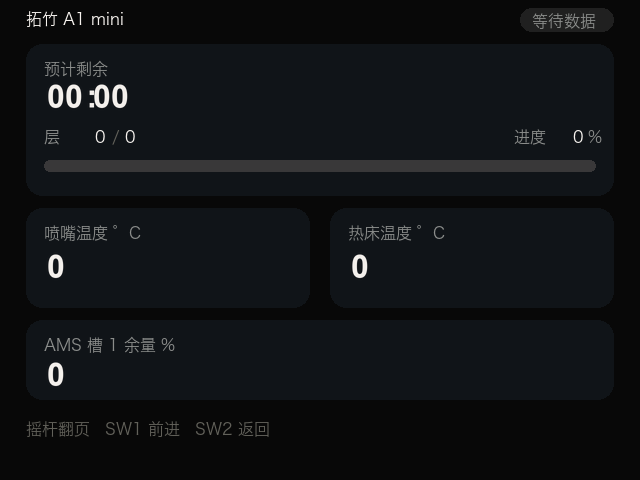

# Bambu Monitor · 拓竹打印机监控

[](https://github.com/UpKiry/bambu-monitor/actions/workflows/check.yml)
[](LICENSE)
[](pyproject.toml)
[](#项目状态)

面向 **ESP32-P4 / PetUI** 的 640×480 拓竹打印机监控组件，用三个页面展示打印任务、环境温度和 AMS 耗材信息。

A Bambu Lab printer dashboard prototype for ESP32-P4 / PetUI, with offline build tools and a provider-independent telemetry contract.

> **当前设备界面仍是显示原型，尚未连接真实打印机数据。** 页面中的 `00:00` 和 `0` 是初始化占位值。已实现 PC 离线核心、真实 HTTP/云 MQTT 适配和私有终端采集入口；真实账号/固件验证、宿主投影与设备显示待验收。

## 界面预览

| 打印任务 | 环境温度 | AMS 耗材 |
| :---: | :---: | :---: |
|  |  |  |

这些图片由离线渲染工具生成，不是实时遥测或设备实拍。

## 项目状态

| 能力 | 状态 |
| --- | --- |
| 三页布局、13 个显示变量、六个按键翻页 | 已实现声明结构，实机画面待验收 |
| 隔离构建、预览、明确文件清单打包 | 已实现 |
| 数据契约、合成样例、离线检查和 CI 配置 | 已实现；CI 运行结果见上方徽章 |
| PC 离线解析、身份/质量缓存、fake HTTP/MQTT与CLI回放 | 已实现，见[操作说明](docs/OFFLINE-CORE.md)及[实施证据](docs/M1-VERIFICATION.md) |
| Bambu Cloud HTTP、云 MQTT 及前台采集入口 | 代码与离线传输测试已实现；[使用说明](docs/CLOUD-COLLECTOR.md)，真实账号/云/固件仍pending |
| 私有手机号／邮箱登录、系统凭据库与本地退出登录 | 已实现；国区手机号密码／短信验证码支持见[验证记录](docs/PHONE-LOGIN-VERIFICATION.md)，真实账号与密钥库仍待验证 |
| 本地引导窗口、设置保存与监控首页 | 已实现；[使用说明](docs/SETUP-WIZARD.md)，真实 Tk 合成交互通过；真实云与密钥库待联调 |
| macOS 后台托盘、localhost 完整登录/设置 | 已实现；原生托盘、独立进程、Chromium 合成流程通过；[使用说明](docs/LOCAL-SERVICE.md)，真实云和 launchd 登录恢复仍待验证 |
| 自定义界面的实时变量下发 | [M0审计](docs/M0-HOST-AUDIT.md)已完成可取得证据核实；生产宿主源码与设备能力待取得 |
| 打印机本地 MQTT | 后续计划 |

组件 ID 为 `bambu-monitor`，版本 `0.1.6`，运行时为 `p4-bounded-runtime-v4`。现有 [组件包](dist/bambu-monitor-0.1.6.hachiapp)是显示原型，不包含云端数据提供器。

## 数据接入方向

**已选择方案 A：自研 Bambu Cloud 适配器。** 优先实现云认证、设备发现和云 MQTT 遥测，以后增加本地 MQTT。云端 HTTP 用于认证和元数据，云 MQTT 用于实时状态，不要求电脑连接打印机的局域网 MQTT。

```text
Bambu Cloud HTTP + 云 MQTT → 自研采集器 → 统一快照 → Pet Manager宿主适配 → PetUI显示
打印机 LAN MQTT（后续）───────────────────┘
```

这是目标数据流。共用核心已有离线验证，并已实现真实网络入口、私有终端认证和前台调度，等待用户本机真实云联调；M0生产通路和真实握手仍pending，不能宣称已上屏。Python不在组件包或ESP32内执行。

从 [需求规格](docs/REQUIREMENTS.md)、[实施计划](docs/IMPLEMENTATION-PLAN.md)与 [验收矩阵](docs/ACCEPTANCE.md)阅读；准备在新对话实施时使用 [交接文档](docs/HANDOFF.md)。B（pybambu）和 C（HA）的 [历史比较](docs/CLOUD-OPTIONS.md)保留供追溯，不再作为待选项。

相关云协议由社区源码核实，并非官方稳定开放 API；区域、验证码/MFA和token失效处理见 [协议研究](docs/CLOUD-PROTOCOL.md)。

统一模型区分有效 `0`、未知、不支持与过期。已有composition/bridge适配器限制为8项，PC fetch则是每来源8项且不适合私网鉴权；当前13变量与质量状态需要独立核对宿主及目标设备支持，不能只靠声明配额推断。

## 快速开始

开发工具要求 **Python 3.11+**。仅做本地检查、构建和预览，不需要打印机、Bambu 账号或 Pet Manager。

```bash
git clone https://github.com/UpKiry/bambu-monitor.git
cd bambu-monitor

python3 -m venv .venv
. .venv/bin/activate
python -m pip install -e '.[dev]'

python tools/project.py check
python tools/project.py build
python -m bambu_monitor check-config examples/provider.example.toml
python -m bambu_monitor replay examples/replay.synthetic.ndjson
```

回放每行输出带 `input_class=synthetic` 的快照与PC诊断，不联网、不发送到屏幕。完整输入格式、profile与生命周期边界见 [离线核心](docs/OFFLINE-CORE.md)。

macOS 建议安装 `python -m pip install -e '.[cloud,tray]'`，然后双击 [start-monitor.command](start-monitor.command) 或运行 `python -m bambu_monitor service --background`。采集器以托盘进程留在后台，通过 `127.0.0.1:8765` 浏览器页面完成登录、验证码、设备选择、保存和启停；从托盘打开设置页，关闭网页后继续采集。可选登录时启动、自动恢复及安全边界见[后台服务](docs/LOCAL-SERVICE.md)。旧 Tk `setup` 和 NDJSON `collect` 入口保留，见[本地向导](docs/SETUP-WIZARD.md)与[云采集](docs/CLOUD-COLLECTOR.md)。真实云账号和设备显示仍待联调。

Windows PowerShell 使用 `.venv\Scripts\Activate.ps1` 激活；也可直接调用虚拟环境里的 Python。

### 预览

```bash
python tools/project.py preview
```

默认输出三张图片到 `.build/preview/`，需要本机可用的中文字体。macOS / Linux 支持自动查找，也可以手动指定：

```bash
python tools/project.py preview --font /path/to/cjk-font.ttc
```

Linux 可安装 `fonts-noto-cjk`。跨平台中文字形可能不同；普通构建复用仓库中的字模，只有显式执行 `glyphs` 才会重建它。

### 打包到设备组件

打包需要单独安装 Pet Manager 维护的 PetUI CLI：

```bash
python tools/project.py pack
# 或指定工具位置
python tools/project.py pack --petui /path/to/petui
```

输出为 `.build/bambu-monitor-0.1.6.hachiapp`，命令会调用官方打包器和校验器，不自动发布或同步。可在 Pet Manager 组件中心导入包，再打开同一组件卡片执行“保存并同步”；同步前须满足目标设备能力要求。

构建仅收录明确清单内的组件文件，源码、测试、示例和凭据不会随组件打包。更多参数、字体与基线更新方式见 [开发指南](docs/DEVELOPMENT.md)。

## 交互

| 输入 | 行为 |
| --- | --- |
| 摇杆上 / 右、SW1 | 下一页 |
| 摇杆下 / 左、SW2 | 上一页 |

三个页面循环切换。退出由设备全局设置负责，组件不占用 SW3。关键读数布局结束于 y ≤ 400，中文正文保持 16 px，大号数字使用字模图集；裁切、字体和颜色仍需实机验证。

## 工程结构

```text
bambu-monitor/
├── package/       # 组件资源与生成 JSON 基线
├── tools/         # 统一入口、布局生成、预览和检查
├── schemas/       # 来源无关的内部数据契约
├── src/bambu_monitor/ # PC离线核心、传输边界与CLI
├── examples/      # 合成快照、非秘密配置和有标签回放
├── tests/         # 契约、遥测状态与fake集成测试
├── docs/          # 架构、协议、方案、开发与验证记录
├── design/        # 三页离线参考图
├── dist/          # 已有组件包
└── .github/       # CI 配置
```

默认产物进入 `.build/`，不覆盖正式组件资源。布局与变量由 [生成脚本](tools/build_package.py)维护，[运行清单](package/runtime/widget.json)用于基线比对；[统一入口](tools/project.py)负责开发命令。

## 文档

| 文档 | 内容 |
| --- | --- |
| [需求规格](docs/REQUIREMENTS.md) | 方案 A 的目标、MVP范围、功能与非功能需求 |
| [实施计划](docs/IMPLEMENTATION-PLAN.md) | 架构决策、宿主证据、M0–M6及阶段退出条件 |
| [验收矩阵](docs/ACCEPTANCE.md) | FR/NFR对应的离线、云端与实机验证 |
| [新会话交接](docs/HANDOFF.md) | 已选决策、环境、已知缺口和可复制的启动消息 |
| [云端接入历史比较](docs/CLOUD-OPTIONS.md) | 三种路线及选择 A 的记录 |
| [云协议研究](docs/CLOUD-PROTOCOL.md) | 区域、认证、设备接口、MQTT 与固定版本证据 |
| [架构与边界](docs/ARCHITECTURE.md) | 采集、缓存、显示投影与设备宿主的职责 |
| [数据契约](docs/DATA-ADAPTER.md) | 字段映射、增量、缺测与过期规则 |
| [开发指南](docs/DEVELOPMENT.md) | 环境、检查、构建、预览、打包 |
| [路线图](docs/ROADMAP.md) | 后续实施顺序及验收条件 |
| [M2/M3云采集使用](docs/CLOUD-COLLECTOR.md) | 安装、私有登录、前台采集、凭据与实际限制 |
| [M2/M3验证](docs/M2-M3-VERIFICATION.md) | 真实适配器离线测试、审查修复与待真实验证项 |
| [公开项目参考](docs/CLOUD-REFERENCES.md) | 固定版本、交叉证据、取舍和许可 |
| [M0宿主审计](docs/M0-HOST-AUDIT.md) | 本机真实版本、8项限制、13项/状态预算、生产源码与能力缺口 |
| [M1离线操作](docs/OFFLINE-CORE.md) | 可运行CLI、模块与生命周期、输入和安全边界 |
| [M1验证记录](docs/M1-VERIFICATION.md) | 本轮代码/测试与待验证层次 |
| [协议profile](docs/PROTOCOL-PROFILES.md) | 候选字段、身份、基线与纯离线测试标记 |
| [验证记录](docs/VERIFICATION.md) | 既有工程检查与本轮证据入口 |

## 测试与贡献

```bash
python tools/project.py check
```

检查覆盖生成一致性、13 个变量绑定、三页 × 六输入的 18 条翻页路径、PNG 资源、JSON Schema 和数据契约测试。它不连接云端、打印机或 USB，也不代表实机验收通过。GitHub Actions 在 Ubuntu / Python 3.11、3.12、3.13 上运行离线构建、检查和预览。

欢迎通过 Issue 或 Pull Request 参与。报告兼容问题时请附 Python / 操作系统版本，以及相关机型、固件和脱敏错误；提交代码前运行检查，说明改动目的与验证方式。界面改动请附预览，保持生成逻辑与组件基线一致。

不要在 Issue、PR、日志或组件中提交密码、验证码、云 token、LAN Access Code 或原始账户响应。[配置示例](examples/provider.example.toml)由离线加载器读取，严格拒绝秘密或未声明字段；当前有私有TTY登录CLI，尚未真实账号验收；不要把秘密放进命令参数。

## 开源协议

本项目自行编写的代码和文档采用 [MIT License](LICENSE)，允许使用、修改和再分发，保留版权与许可声明即可。依赖、系统字体及第三方参考遵循各自许可，详见 [第三方说明](THIRD_PARTY_NOTICES.md)。

Bambu Lab / 拓竹等名称和商标属于其权利人。本项目是独立社区项目，与 Bambu Lab 没有官方隶属或背书关系。
