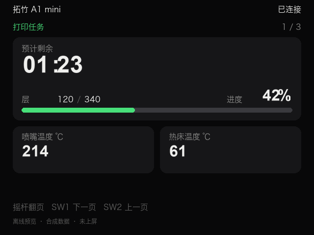
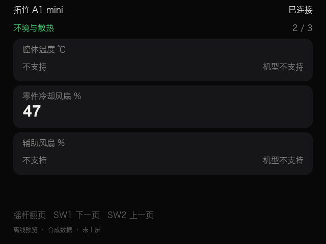
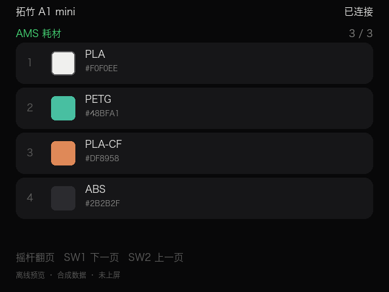
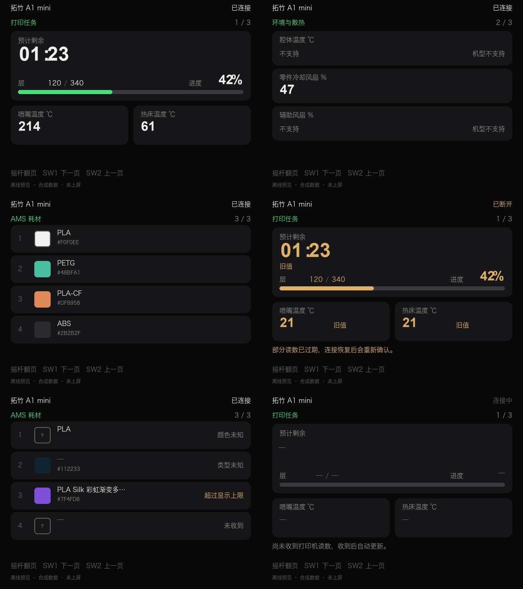

# Bambu Monitor · 拓竹打印机监控

[](https://github.com/UpKiry/bambu-monitor/actions/workflows/check.yml)
[](LICENSE)
[](pyproject.toml)

Bambu Cloud 只读采集器，以及面向 ESP32-P4 / PetUI 的三页打印机监控组件。macOS 采集端可在后台运行，通过托盘查看状态，在浏览器中登录、选择打印机和调整设置。

**当前已完成采集代码、本地界面与合成测试，真实云账号和设备显示仍待验收。** 设备界面中的 `00:00`、`0` 是初始化占位值；本机网页可用不代表 USB 或设备上屏已接通。

## 启动采集端

macOS 图形登录会话、Python 3.11+，在项目目录执行：

```sh
python3 -m venv .venv-dev
.venv-dev/bin/python -m pip install -e '.[cloud,tray]'
.venv-dev/bin/python -m bambu_monitor service --background
```

安装完成后也可双击 [start-monitor.command](start-monitor.command)。从托盘选择“打开本机设置…”，在本机 `127.0.0.1:8765` 页面选择账号区域、登录、明确选择打印机并保存。关闭网页和启动终端后，后台采集可继续运行。

普通设置不保存密码、验证码或云令牌；令牌使用系统钥匙串，不可用时仅保留在本次内存。后台网页现展示全部九项机器指标，以及 AMS 四槽的耗材类型/颜色，另可展开全部已观测字段、最新脱敏遥测 JSON 和连接诊断；数据仅内存保存。“刷新本机读数”重读缓存，不强制云端推送。AMS lite 的新目标不再是余量；设备组件尚未改为类型/颜色或接通实时上屏。程序不提供打印控制，不连接打印机 LAN MQTT。完整操作、更新后重启方式、可选登录时启动、CLI 和旧 Tk 入口见[使用指南](docs/LOCAL-SERVICE.md)。

## 项目状态

| 范围 | 当前状态 |
| --- | --- |
| 云 HTTP/MQTT、认证、设备发现、增量与质量处理 | 已实现并通过离线/合成测试；真实账号、区域及固件待验证 |
| macOS 后台进程、原生托盘、浏览器配置 | 已实现；原生运行与 Chromium 合成流程通过；系统钥匙串、launchd 登录恢复待实测 |
| 组件构建、三页/13 变量与按键声明 | 离线检查通过；组件 ID `bambu-monitor`、版本 `0.1.6` |
| 设备展示模型与三页降级状态 | 离线实现；36 项展示测试通过，可渲染 18 帧预览；真实数据与上屏待接入 |
| Pet Manager 宿主投影、USB 与设备显示 | 阻塞：宿主没有通用本机数据通道；不改宿主、无 WiFi、无公网端点时无法上屏，见[验证状态](docs/VERIFICATION.md) |

验证范围及剩余验收清单集中在[验证状态](docs/VERIFICATION.md)。采集器运行在电脑上，不包含在设备组件包内。

## 设备界面预览

| 打印任务 | 环境温度 | AMS 耗材 |
| :---: | :---: | :---: |
|  |  |  |

这些是离线渲染参考，不是实时遥测或实机照片。摇杆上/右、SW1 翻至下一页；摇杆下/左、SW2 翻至上一页，三页循环，SW3 留给设备全局操作。

### 下一版界面（展示模型预览，尚未上屏）

| 打印任务 | 环境与散热 | AMS 耗材 |
| :---: | :---: | :---: |
|  |  |  |



上图依次为实时、断连旧值、部分缺失和未收到数据。它们由[展示模型](src/bambu_monitor/display.py)读取快照与 AMS 材料后渲染，`python tools/project.py display-preview` 可复现，数据为明确标记的合成输入。**组件包仍是上一节的 0.1.6 静态占位布局**：把 17 个带质量的字段送上设备还缺动态颜色、质量文本和更宽的投影通道，原因见[架构](docs/ARCHITECTURE.md)。

## 开发与文档

```sh
.venv-dev/bin/python -m pip install -e '.[dev,cloud]'
.venv-dev/bin/python tools/project.py check
.venv-dev/bin/python tools/project.py build
.venv-dev/bin/python tools/project.py preview
```

检查、构建不需要账号或打印机；预览需要本机中文字体。默认产物进入 `.build/`，打包遵循明确资源清单，不自动发布或同步。

| 文档 | 内容 |
| --- | --- |
| [使用指南](docs/LOCAL-SERVICE.md) | 安装、后台/托盘、浏览器登录、CLI、配置与故障处理 |
| [开发指南](docs/DEVELOPMENT.md) | 环境、测试、预览、构建、组件打包和基线更新 |
| [架构与边界](docs/ARCHITECTURE.md) | 当前模块、生命周期、安全约束与待实现的宿主接入 |
| [数据契约](docs/DATA-ADAPTER.md) | 快照、13 项映射、质量/时间/身份规则和离线回放 |
| [云协议与参考](docs/CLOUD-PROTOCOL.md) | 当前协议子集、兼容限制、固定来源和许可 |
| [验证状态](docs/VERIFICATION.md) | 已验证范围、复现命令与真实云/系统/设备待验收项 |

历史选型、阶段计划、交接和单次修复记录已合并到以上主题文档，历史版本可从 Git 查看。贡献代码前运行检查；不要在源码、日志、Issue 或组件包中放入凭据和原始账户响应。

## 许可

本项目采用 [MIT License](LICENSE)。依赖、系统字体及公开参考遵循各自许可，见[第三方说明](THIRD_PARTY_NOTICES.md)。Bambu Lab / 拓竹等名称和商标属于其权利人，本项目与 Bambu Lab 没有官方隶属或背书关系。
