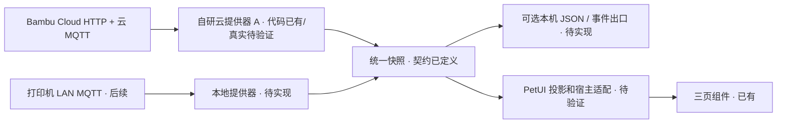

# 架构与边界

## 当前工程做什么

当前工程负责PetUI显示组件、离线构建及PC采集器。真实HTTP/云MQTT适配、私有TTY/凭据库与前台调度代码已有离线测试，实际云验证及宿主投影尚未完成，见[当前使用](CLOUD-COLLECTOR.md)和[本轮证据](M2-M3-VERIFICATION.md)。**已选择A自研Bambu Cloud适配器**；M0审计/M1实现见 [审计](M0-HOST-AUDIT.md)、[离线模块](OFFLINE-CORE.md)与[本轮验证](M1-VERIFICATION.md)。B/pybambu和C/HA为历史备选，本地MQTT后续再做。执行入口见 [需求](REQUIREMENTS.md)、[计划](IMPLEMENTATION-PLAN.md)与 [验收](ACCEPTANCE.md)，旧工程验证见 [历史记录](VERIFICATION.md)。



箭头表达计划的数据流，不代表已经连通。云方案见 [选型文档](CLOUD-OPTIONS.md)。

## 四个职责层

### 1. 提供器：连接和协议

云提供器负责账号区域、交互认证、设备发现、云 MQTT 订阅、重连和原始消息解析；本地提供器以后负责 IP、Access Code 和局域网 MQTT。HA 方案负责选定实体和 HA REST/WebSocket 会话。

提供器只暴露规范化遥测，不把密码、token 或设备列表中的 `dev_access_code` 透传出去。第一阶段只做监控，不提供暂停、加热、运动或打印控制。读取初始化命令采用明确白名单，避免把通用 publish 入口开放给组件。

云连接的 HTTP 元数据和 MQTT 实时遥测用途不同。MQTT broker 已连接、打印机已在线、已接收完整状态是三个独立事实。新提供器应具备明确的认证状态机：

```text
unconfigured → auth_required → connecting → online
                                  │           │
                                  └→ error    └→ offline → connecting
凭据失效：任意已认证状态 → auth_required（由用户重新认证）
```

`online` 必须有目标打印机的有效遥测依据，不能只凭broker CONNACK。恢复连接后，实际出现的字段才更新其观测时间；未出现字段保留旧值和旧时间，但是否仍valid要结合协议profile、代次、基线和任务/耗材作用域判断，不能一律按60秒无变化失效。详见 [FR-08](REQUIREMENTS.md)。

### 2. 状态缓存和统一快照

[内部快照 Schema](../schemas/printer-snapshot.schema.json)是本次定义的设计契约，适用于三种来源，不是已实现 HTTP API 或 USB 线协议。温度保留原始数值精度，剩余时间保留分钟，AMS 保留单元/槽 ID。

每个读数字段同时保存 `value`、`quality`、`updated_at`，区分真实 0、未知、不支持和过期。仅更新 `generated_at` 不能延长数据有效期。增量消息按字段合并，AMS 按单元与槽 ID 合并；列表中的空槽、明确移除和本次没有上报必须区分。

快照中的 `connection` 表示当前提供器对目标打印机遥测可用性的判断。HA 桥接的 `unknown/unavailable` 应映射到质量和连接状态；HA REST 查询成功不能让不变的旧读数重新变新鲜。字段来源/时间不足时标为未知，不能编造时间。

### 3. 显示投影

投影层将内部模型转换为当前 UI 的 13 个变量，例如分钟转 `HH:MM`、温度取整、选定 AMS 映射到四个槽。来源切换不应要求重写布局。

当前 UI 的温度、风扇和槽余量均是整数变量，没有原生空值显示；“等待数据”和机型名称也写死。后续需要质量状态和能力驱动的显示逻辑，这属于单独的 UI 迭代，先展示预览再实施。合成样例不能直接灌入正式屏幕冒充实时。

### 4. 宿主与设备传输

旧文档把 `widget/data` 当作任意变量更新通道，这一点不能成立为已确认能力。本机 PetUI 技能的实时数据文档描述的是有界 rows 列表快照；当前组件使用自定义 surface 和 `var_bind`，不能直接套用列表行协议。

本机PetUI 0.1.232参考中存在`app/snapshot`变量投影路径；对应production源码、实际设备协商和13变量接收尚未核实。离线校验器已确认composition总变量≤8、service bridge绑定≤8；PC fetch是每来源8项，拆8＋5可过声明校验，但其不支持Authorization、本机HTTP/私网且轮询≥60秒，不能直接消费本项目的私有实时采集器。

M0按 [实施计划](IMPLEMENTATION-PLAN.md)执行：

1. 读取目标Pet Manager与设备实际能力，核对真实宿主源码、快照和传输预算。
2. 用明确标记的离线合成快照检查单标量、实例身份、断连和迟到消息，不冒充实时云数据。
3. 验证完整13项及质量状态的预算和接收，不能因v2一般16vars就认定宿主路径已支持。
4. 若需外部产品修改，先列出具体源码和授权范围，不直接改安装应用、技能或固件，不默降UI。
5. USB复用宿主传输管理。M0缺少设备或源码时继续M1离线核心，分别记录未验证条件。

仅有PC快照输出不等于屏幕刷新；真实云和实机链路在后续阶段分别验收。

## 仓库与生成边界

- [组件资源](../package/runtime/widget.json)：已提交基线；[生成脚本](../tools/build_package.py)维护布局与变量。
- [工程入口](../tools/project.py)：检查、受控构建、预览、打包；普通构建写入 `.build/`。
- [Schema](../schemas/printer-snapshot.schema.json)和[样例](../examples/snapshot.cloud.example.json)：只在 PC 开发/测试使用，不打入组件。
- [配置样例](../examples/provider.example.toml)：已有严格非秘密加载器及check-config，真实凭据入口仍待实现。
- M1实际模块和可运行命令见 [离线操作](OFFLINE-CORE.md)，状态缓存与传输边界已有fake/回放验证；图中真实云和宿主箭头仍为目标。

本轮文档准备不改组件ID、版本和视觉布局，不自动清理用户副本，不覆盖原有发布包。本次工程检查与正式PetUI解释器、设备验收的关系见 [开发指南](DEVELOPMENT.md)。

## 安全和运行边界

密钥优先使用系统凭据库，不可用时首版默认仅会话内存；不自动回退明文文件。日志仅记录脱敏事件、错误类别和重试时间，不输出完整账户响应、认证头或原始payload。Schema拒绝额外字段不能替代实际脱敏。

首版提供本地诊断/快照输出，不预设HTTP/SSE路由。M0若选独立服务入口，才定义受控IPC、访问鉴权和生命周期，默认限制同机；跨机NAS/公开HTTPS是后续部署范围。不把token放进组件或设备，不直接公开用户遥测，本阶段不接本地MQTT。
