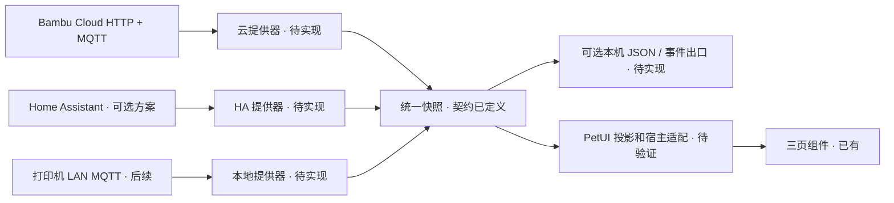

# 架构与边界

## 当前工程做什么

当前工程负责一个 PetUI 显示组件和离线构建，不是已经运行的打印机数据服务。云端与本地采集方式尚未选定，不能从包中取得真实数据。具体状态见 [验证记录](VERIFICATION.md)。



箭头表达计划的数据流，不代表已经连通。云方案见 [选型文档](CLOUD-OPTIONS.md)。

## 四个职责层

### 1. 提供器：连接和协议

云提供器负责账号区域、交互认证、设备发现、云 MQTT 订阅、重连和原始消息解析；本地提供器以后负责 IP、Access Code 和局域网 MQTT。HA 方案负责选定实体和 HA REST/WebSocket 会话。

提供器只暴露规范化遥测，不把密码、token 或设备列表中的 `dev_access_code` 透传出去。第一阶段只做监控，不提供暂停、加热、运动或打印控制。读取初始化命令采用明确白名单，避免把通用 publish 入口开放给组件。

云连接的 HTTP 元数据和 MQTT 实时遥测用途不同。MQTT broker 已连接、打印机已在线、已接收完整状态是三个独立事实。新提供器应具备明确的认证状态机：

```text
unconfigured → auth_required → connecting → online
                                  │           │
                                  └→ error    └→ offline → connecting
凭据失效：任意已认证状态 → auth_required（由用户重新认证）
```

`online` 必须有目标打印机的有效遥测依据，不能只凭 broker CONNACK。恢复连接后只在收到新消息的字段上更新时间；没有更新的字段继续老化。

### 2. 状态缓存和统一快照

[内部快照 Schema](../schemas/printer-snapshot.schema.json)是本次定义的设计契约，适用于三种来源，不是已实现 HTTP API 或 USB 线协议。温度保留原始数值精度，剩余时间保留分钟，AMS 保留单元/槽 ID。

每个读数字段同时保存 `value`、`quality`、`updated_at`，区分真实 0、未知、不支持和过期。仅更新 `generated_at` 不能延长数据有效期。增量消息按字段合并，AMS 按单元与槽 ID 合并；列表中的空槽、明确移除和本次没有上报必须区分。

快照中的 `connection` 表示当前提供器对目标打印机遥测可用性的判断。HA 桥接的 `unknown/unavailable` 应映射到质量和连接状态；HA REST 查询成功不能让不变的旧读数重新变新鲜。字段来源/时间不足时标为未知，不能编造时间。

### 3. 显示投影

投影层将内部模型转换为当前 UI 的 13 个变量，例如分钟转 `HH:MM`、温度取整、选定 AMS 映射到四个槽。来源切换不应要求重写布局。

当前 UI 的温度、风扇和槽余量均是整数变量，没有原生空值显示；“等待数据”和机型名称也写死。后续需要质量状态和能力驱动的显示逻辑，这属于单独的 UI 迭代，先展示预览再实施。合成样例不能直接灌入正式屏幕冒充实时。

### 4. 宿主与设备传输

旧文档把 `widget/data` 当作任意变量更新通道，这一点不能成立为已确认能力。本机 PetUI 技能的实时数据文档描述的是有界 rows 列表快照；当前组件使用自定义 surface 和 `var_bind`，不能直接套用列表行协议。

所有云方案均需共同完成一次宿主能力验证：

1. 读取真实 Pet Manager 与设备协商能力。
2. 核对是否已有通用的 host/service 字段到 surface 变量映射，而非只支持 rows。
3. 用真实采集快照验证一个标量和缺测状态，再扩大到全部字段。
4. 若缺少通用映射，需要另行确定 Pet Manager/固件代码范围；不能靠新增 `data.source="bambu.printer"` 声称接通。
5. USB 写入复用宿主传输管理，不能由采集进程抢占串口。

本次没有该产品源码的修改和实机能力核验。若先做独立本机 JSON 服务，它可以验证采集结果，但不等于屏幕已刷新。

## 仓库与生成边界

- [组件资源](../package/runtime/widget.json)：已提交基线；[生成脚本](../tools/build_package.py)维护布局与变量。
- [工程入口](../tools/project.py)：检查、受控构建、预览、打包；普通构建写入 `.build/`。
- [Schema](../schemas/printer-snapshot.schema.json)和[样例](../examples/snapshot.cloud.example.json)：只在 PC 开发/测试使用，不打入组件。
- [配置设计样例](../examples/provider.example.toml)：尚无加载器，所有参数都是设计阶段输入。
- 后续选定云方案后再建立 `src/` 提供器与 CLI，避免现在放入不可用的登录或连接桩。

不改组件 ID、版本和视觉布局，不自动清理用户副本，不覆盖原有发布包。本次工程检查与正式 PetUI 解释器、设备验收的关系见 [开发指南](DEVELOPMENT.md)。

## 安全和运行边界

密钥存储优先使用操作系统凭据库；如后续提供文件回退，须显式实现私有权限和迁移策略。日志只记录事件类型、错误类别、重试时间，不打印完整账户响应、认证头、消息凭据或全量 payload。Schema 拒绝额外凭据字段只能约束出口结构，不能代替实际代码脱敏。

未来独立服务默认仅监听 loopback；跨设备访问、公开 HTTPS 中转、认证和部署策略需要另行确定。不直接把用户实时打印数据发布到公共 URL。设备直接连接云 MQTT、在设备保存账号 token、本次接入本地 MQTT 均不在本阶段。
